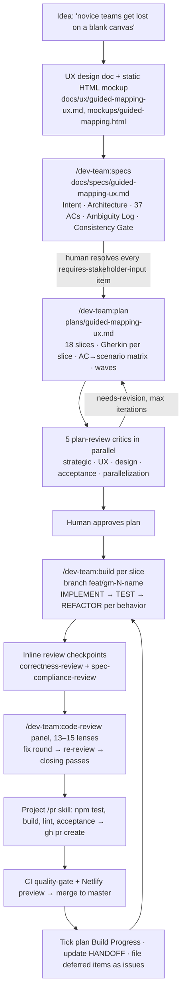
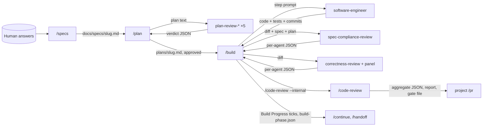

# How vsm-workshop goes from idea to shipped code with AI

Analysis of [bdfinst/vsm-workshop](https://github.com/bdfinst/vsm-workshop), October 2026 only (commits, PRs and issues dated 2026-10-01 onward, plus the spec/plan artifacts those commits consumed). Written 2026-11-08.

**Scope note.** All October activity is one feature: **Guided Mapping v2**. It ran on 2026-10-02 and 2026-10-03 as 138 commits, PRs #20–#29 and #42, and issues #30–#41. The spec and plan are dated 2026-09-30 but first landed in the repo with the Oct 2 foundation commit (`afa6a7c`), so they are covered here.

---

## 1. High-level overview

### The one-paragraph version

Bryan Finster (the owner, sole human) drives everything through the **dev-team plugin**'s pipeline: `/dev-team:specs` → `/dev-team:plan` → `/dev-team:build` → `/dev-team:code-review` → PR. The human's work goes into **resolving ambiguity up front** (a spec with a 40-row Ambiguity Log) and **approving the plan** (3,300 lines, 18 vertical slices, Gherkin per slice, five AI critics, three revision rounds). After that, the AI builds **one slice per PR**. Each slice is reviewed by a multi-agent panel, fixed, re-reviewed, and merged behind a feature toggle (`ui=guided`). Deferred work ends up in the PR body and then in GitHub issues. Session continuity comes from the plan's `## Build Progress` checkboxes plus a `HANDOFF-*.md` file.

### Pipeline diagram



### Artifact inventory

| Stage | Artifact | Path | Size |
|---|---|---|---|
| Problem framing | UX design doc (problems, principles, screen-by-screen) | `docs/ux/guided-mapping-ux.md` | 227 lines |
| Problem framing | Static clickable mockup, one tab per screen | `docs/ux/mockups/guided-mapping.html` | — |
| Spec | Spec: intent, architecture, data model, formulas, 37 ACs, Ambiguity Log, Consistency Gate | `docs/specs/guided-mapping-ux.md` | 479 lines, revision 5 |
| Plan | Implementation plan: slices, Gherkin, steps, waves, review summary, progress | `plans/guided-mapping-ux.md` | 3,303 lines, revision 8 |
| Build | Unit tests, one file per concern, with shared fixtures | `tests/unit/v2/*.test.js` | ~33 files |
| Build | Playwright spec per UI slice | `tests/e2e/guided/slice-<N>-<name>.spec.js` | 6 files so far |
| Continuity | Session handoff | `HANDOFF-guided-mapping-ux.md` | 48 lines |
| Delivery | One PR per slice, with a structured body | PRs #20–#29, #42 | — |
| Follow-up | Deferred work, product questions, "needs a person" items | Issues #30–#41 | 12 issues |
| Harness | Project rules, skills, checklists, hooks | `CLAUDE.md`, `.claude/**` | — |

### What makes it work (the short list)

1. **Ambiguity gets killed before any code.** The spec log classifies every open decision as `requires-stakeholder-input` (the human answered it) or `inferable` (with a written rationale). Slicing and build never have to guess at product intent.
2. **Scenarios are the contract, but they're plain text.** They dropped Cucumber in plan revision 8. Gherkin stays in the plan as spec text, and each scenario becomes one Vitest or Playwright test titled with the scenario name. That traceability costs nothing to keep.
3. **Slices are vertical and toggled.** All 18 slices land on trunk behind `ui=guided`, so v1 stays the default and trunk stays shippable. Deleting v1 is the last slice, gated on a human pilot.
4. **Review is adversarial and repeated.** A slice gets a full panel review, a fix round, then targeted closing passes that review only the fix delta. Commit logs show "review round 2/3".
5. **Nothing is silently dropped.** Every PR body has "Decisions made at the build gate", "Deferred" and "Not covered" sections. Deferred items become issues. Work only a human can do is collected in one issue (#39).
6. **The plan file is the resume record.** `## Build Progress` checkboxes plus a handoff doc let a fresh session continue with `/dev-team:build ./plans/guided-mapping-ux.md`.

---

## 2. Low-level detail, stage by stage

### Stage 0: Problem framing and UX

- `docs/ux/guided-mapping-ux.md` (status "proposed", 2026-09-30) opens with a **"Problems with the current UI" table** of *today* → *effect in a workshop* rows, for example "Opens on a blank free-form canvas → the facilitator does all the driving".
- Six **design principles**, each one testable: "One question at a time", "map is always visible and always live (every edit redraws within 200 ms)", "All views agree", "Honest about unknowns", "Tables are first-class".
- A screen-by-screen walkthrough plus a **static HTML mockup** (one tab per screen, no live data). The spec links both in its header.
- Takeaway: the UX doc is written *before* the spec, so the spec can cite concrete screens and wording. Several principles later show up as hard ACs (AC27's 200 ms budget, AC14's "flags agree across map and summary").

### Stage 1: Spec (`/dev-team:specs`)

Header: `<!-- spec-version: 1 -->` and `**Format:** dev-team /specs v1 · Revision: 5`. The revision note lists what changed in each round.

Sections, in order:

1. **Intent Description.** Who has the problem (novice delivery teams), what is wrong today, and what the change does (seven-stage guided session, time ladder, summary strip, future states, single-file distribution). Plain prose with a few bullets.
2. **Architecture Specification.** Very concrete:
   - In / Out / Unchanged-platform scope lists. "Out" names the separate specs to come later.
   - **Data model table** (schema v2): entities, fields and rules. Units are explicit, for example "all durations in whole minutes, percentages 0–100".
   - Persistence and distribution rules down to IndexedDB DB names, debounce timings (500 ms / 2 s), exact status strings, ARIA roles and announcement rules.
   - **Calculations** as named formulas (`LT = PT_total + WT_total + EL_total`, `E_j = (1 − CA_j) × Σ s_jk × R(j,k)`), with the modeling assumption stated *and required to appear in the UI*.
   - Editing rules (store-level validation, refusal messages verbatim), stage rules, layout, migration, components (a table of new / changed / **removed at switch-over** files), constraints.
3. **Acceptance Criteria (37).** Grouped by area. Many are **worked numeric examples**. AC9 gives the reference map's inputs and expected outputs (LT 18.8 days / 9,030 min, flow efficiency 9.6%). AC10 and AC11 change one variable each and give the new numbers. Performance (AC27), a11y (AC28: axe on every stage), gates (AC29) and docs (AC30) are ACs too. **AC31 is a manual pilot gate** with a measurable bar: a novice team completes stages 1–6 for a 10-step stream in under 90 minutes.
4. **Ambiguity Log** (~40 rows). Columns: Decision · Classification · Resolved By · Rationale. Fourteen are `requires-stakeholder-input`, resolved by the human (scope cut, remove simulation, working vs calendar time, rework formula, pilot timing, distribution model…). The rest are `inferable`, each with a one-line rationale. Example: "Unit of work has no default — a default would make the stage 1 gate trivially true."
5. **Consistency Gate** checklist → **Verdict: PASS**.

What the plugin's `/specs` skill (v14.0.1, the version live on Oct 3) enforces to get there:

- Human drafts → agent critiques (gap / ambiguity / conflict / scope violation, each tied to specific text) → human decides → agent refines. **Max 2 iterations per artifact.**
- **Ambiguity Resolution Protocol** (a hard step): try inference → *predictability check* (generate one plausible alternative; if the source doesn't rule it out, it needs a human) → classify → batch every `requires-stakeholder-input` question to the human before writing ACs.
- "Inferable is NOT a convenient default." The test is whether a developer working from context alone would land on the same answer.
- **Completeness sweep**: CRUD per entity plus auth, audit and error handling, so omissions become visible.
- **No Gherkin in the spec.** Scenarios are deferred to `/plan`, per slice.
- Spec-version marker check, so a stale-format spec isn't silently overwritten.

### Stage 2: Plan (`/dev-team:plan`)

`plans/guided-mapping-ux.md` is the central artifact. Header metadata: created, **revision 8** with a note on what changed, branch convention (`feat/gm-<slice>-<name>`), status, scenario persistence (where tests live), links to spec and UX.

Sections:

- **Goal**, plus **Approach stances** from the plugin's `knowledge/decision-defaults.md`. These are explicit choices on high-reversal-cost axes: *replace vs merge* (expand before contract: slices 1–17 only add files plus additive hooks into v1, listing every shared v1 file that is touched and why), *migrate vs edit stub*, *persistence*, *distribution*, *format fidelity*, *integration* (one PR per slice, auto-merge on green) and *scope*.
- **Acceptance Criteria matrix**: each of the 37 spec ACs → the named scenarios and step numbers that verify it. Spec ACs get ticked at PR review of the slice that satisfies them.
- **Conventions for all slices.** This is the test architecture written down once:
  - Scenario → test mapping (logic → Vitest `tests/unit/v2/`, UI → Playwright `tests/e2e/guided/slice-N-*.spec.js`, **one spec file per slice so same-wave slices never edit the same file**).
  - Runners and npm scripts.
  - Fixtures: `makeStore()` with an in-memory repository per test, and a rune-loader proof test.
  - **Seeding**: Givens become `seed(...)` calls that write IndexedDB through a `/__seed` route, so tests never click through earlier stages.
  - **File-system stub** for native pickers, which can't be automated.
  - Dialog handlers, named save-state Givens (`withUnsavedChanges`, `withWriteHeld`…), `walkEveryStage`, clock control (`page.clock`), standalone `file://` runs with network blocked.
  - Shared "reference map" fixtures defined once.
  - Wording rules (e.g. "value stream", never "map", except for the diagram).
- **Slices 1–18.** Each has `Depends-on`, a **Gherkin Feature block** (happy, negative, edge and error scenarios, outlines with Examples), then **steps**. Each step has `Complexity` (trivial / standard / complex), `IMPLEMENT`, `TEST`, `REFACTOR`, `Files` and a pre-written `Commit` message. Example, step 7.2: *IMPLEMENT* insert/move/Alt+arrow/drag with focus and announcement rules → *TEST* named scenarios + axe → *REFACTOR* "keep the reorder rules in the store" → *Commit* `feat(steps): insert and reorder by buttons, keyboard, and drag`.
- Slice 2 is a **spike** (file:// storage behavior per browser) that must end in "Decision: go | adjust" before any persistence code. Slice 17 is the **manual pilot**. Slice 18 is **switch-over and deletion**, gated on 17.
- **Parallelization**: Mermaid DAG plus a 13-wave table generated by the plugin's `plan_waves.py`. Their caveat is honest: the script didn't parse their `Files:` lines, so collision checking was done by hand.
- **Complexity classification**, **Pre-PR Quality Gate** checklist (tests, build, lint, scenarios exist as tests with matching titles, acceptance + axe, `/code-review`, "v1 still works without the toggle").
- **Skipped (low value)**: work deliberately *not* planned, with a one-line rationale.
- **Risks & Open Questions** (17 bullets, each with its mitigation).
- **Build Progress**: checkboxes grouped by wave, annotated with test counts as they complete ("built, 84 unit tests"). This is the resume record.
- **Plan Review Summary**: tier `complex`, five reviewers, three iterations (cap reached), final verdicts, and an explicit note that the rev 8 tooling change (drop Cucumber) **was not re-reviewed by agents** and went back to the human for approval.

What the plugin's `/plan` skill enforces:

- No implementation. Every step is one behavior with a full IMPLEMENT → TEST → REFACTOR cycle and leaves trunk committable.
- Vertical slices sequenced so trunk stays releasable (toggles, expand-before-contract).
- Gherkin per slice covering happy, negative, edge and error cases. Every spec AC is covered by at least one scenario.
- `plan_waves.py` derives the waves (never hand-written). Collisions block. Scope mismatches are surfaced.
- **Tiered review**: trivial → acceptance critic only; standard → 2–4 critics; complex → all five (`plan-review-acceptance`, `-design`, `-ux`, `-strategic`, `-parallelization`) in parallel. Blockers get revised. Max 2 iterations, then escalate.
- Human approval gate, recorded in `.claude/metrics/config-changelog.jsonl`. Non-interactive auto-approve is allowed but always written into the plan.
- Optional: export Gherkin to `.feature` files after approval (they chose "plan-file-only"), and an offer to open parent + per-slice GitHub issues (`/issues-from-plan`), which they declined. No slice issues exist.

### Stage 3: Build (`/dev-team:build`)

Per slice, from the handoff doc and commit history:

1. Branch `feat/gm-<N>-<name>` from `master`.
2. `/dev-team:build ./plans/guided-mapping-ux.md` resumes at the next unchecked step.
3. **Per behavior: IMPLEMENT → TEST → REFACTOR.** This is the plugin's "Code-First Small Batches" cadence, and refactor runs on every green. Commits follow the plan's pre-written messages (`feat(steps): step list, reorder, outside steps and safe delete`), then `refactor(...)`, `test(...)` and `fix(...)` commits.
4. **Inline review checkpoints**, scaled by step complexity. The handoff names the agents: `software-engineer` for builds and fixes, `correctness-review` and `spec-compliance-review` for slice reviews. `complex` steps (3.1 migration, 4.1 store, 11.1 file saver) get per-step review.
5. **Slice review**, then fix commits (`fix(time): apply slice 8 review findings`, `…round 2…`, `…round 3…`).
6. Mark steps `[x]` in the plan with test counts.
7. Plugin extras run at the end of a build: runtime verification of the slice (4.9), the full suite (whole suite must be green, *including pre-existing failures*), a backstop code review, a Farley test-quality score (informational), and an evidence bundle for the PR.

Decisions made mid-build are written back into the plan and spec. Example commits: `docs(plan): Slice 10 follow-up scenarios…`, `docs: name the new map pieces … in the spec and plan`. A scenario amended at the build gate is called out in the PR ("Scenario amended: 41 steps scroll in Equal width").

Example of follow-up depth: the Slice 10 follow-up (PR #42) spent 21 commits making SVG label-width estimates match Chromium's font rendering, down to "a capital is 0.73 em, above the 64th of a pixel the browser rounds H and N up to". The e2e oracle sweeps printable ASCII one character at a time. Reviewers push for real verification, not plausible numbers.

### Stage 4: Code review (`/dev-team:code-review`)

- Run before every PR, both by the project's `/pr` skill and by the plan's Pre-PR gate.
- PR bodies report what was run: "`/code-review` panel (15 lenses) plus re-review of fixes" (#21), "Full 13-agent panel, a fix round, and targeted closing passes (correctness, a11y, test) on each fix delta" (#24), "Correctness, structure, test and a11y passes, one fix round, then closing correctness and test passes and a last pass on the final commit" (#42).
- **Pattern: full panel → fix → narrow re-review of only the fix delta → final pass on the last commit.** Findings are fixed in-branch, not deferred, unless they're out of the slice's scope.
- Review-driven refactors became their own PR when they were too big for the slice: PR #29 "domain helpers and rules from Slices 9 and 10 (A2)", 25 commits of `refactor(model)` and `refactor(store)`.

### Stage 5: PR and merge

- The project `/pr` skill (9 lines) runs `npm test && npm run build && npm run lint`, then `npm run test:acceptance` if behavior changed, then `/dev-team:code-review` with fixes, then `gh pr create`.
- **PR body template** (consistent across #21, #24 and #42):
  - **Summary**, by plan step number (10.1, 10.2…)
  - **Verification / Test plan**, with exact counts ("1854 passed", "238 passed") and **unchecked boxes for what was *not* verified** ("visual.spec.js not run against the pinned image locally")
  - **Review**: which panel ran and what it fixed
  - **Decisions made at the build gate (recorded in the plan)**
  - **Decisions to check**: things the human should look at
  - **Deferred (not in this PR)** and **Not covered**
  - 🤖 Generated with Claude Code
- CI (`.github/workflows/ci.yml`, `quality-gate` check): install once → build app + standalone file → lint + unit → e2e + visual regression in a **digest-pinned Playwright container**. Actions are pinned by SHA. Renovate automerges deps that pass CI, except `.nvmrc`. A Netlify deploy preview posts on every PR.
- `master` is protected: PR plus `quality-gate`. Merges are merge commits, not squashed, so the per-behavior commits survive.
- Visual baselines are regenerated **only** in the pinned image (`npm run test:e2e:baseline` via `scripts/e2e-baseline.sh`), never on a Mac.

### Stage 6: Follow-up and continuity

- **Issues #30–#41**, all opened on 2026-10-03 from deferred PR items, in four kinds:
  - *Standing rules* turned into an audit checklist: #30, "no field may fail silently", a product-owner rule with done and to-do fields.
  - *Deferred refactors / small enhancements* (#31–#34, #40, #41), each with checkbox items and the files named.
  - *Product decisions to confirm* (#38): wording and behaviors "currently settled by whatever the code does".
  - *Needs a person* (#39): dry run, Safari, real file picker, pilot. Explicitly "cannot be done by an agent".
  - *New slice needing approved scenarios first* (#37, "Slice 10b"): draft Gherkin in the issue body, labeled "Needs approved scenarios before any code (ATDD rule)".
- **Handoff doc** `HANDOFF-guided-mapping-ux.md`: the resume command, current state (PR numbers, branch, test counts), **decisions in force**, architecture notes, known open items, and numbered next steps. They delete it once the work is done (`9a096a8 docs: remove completed handoff files`).

### Throughput

Oct 2–3: slices 1–10 of 18, plus a follow-up PR, a refactor PR, two CI PRs and a mutation-testing PR. The test suite went from 1,269 to 2,079 unit tests and 249 guided e2e tests. Commits co-authored by "Claude Sonnet 5.5" carry the trailer (20 of 138); the rest have none.

---

## 3. How the dev-team plugin integrates

**Yes, it's central.** It's wired in at three levels.

### Installation and wiring

- `.claude/settings.json` registers the marketplace `bfinster` → `github.com/bdfinst/agentic-dev-team` with **`autoUpdate: true`** and enables `dev-team@bfinster`. They always run the latest plugin.
- **SessionStart hook** `.claude/install-dev-team.sh` (matcher `startup`) installs the plugin if it's missing. It's fail-open, time-boxed to 120 s, and opt-out via `DEV_TEAM_CLOUD_INSTALL=0`, so cloud / claude.ai/code sessions get it too. A second hook installs Playwright Chromium so the agent can self-verify UI.
- **PostToolUse hook**: prettier on `.js/.svelte/.json/.css/.md`, plus `eslint --fix` on JS/Svelte after every Edit/Write.
- `.claude/project-stack.json` (written by `/dev-team:setup` / `project-init` on 2026-09-30): stack signal javascript/node, svelte/vitest/playwright/cucumber.
- Repowise and CodeGraph indexes for code lookup (same setup as ours).

**Version.** Their October work ran on dev-team **v14.0.0** (released 2026-10-01) and **v14.0.1** (released 2026-10-03). Current is **v14.2.0** (2026-11-06). Changes since then that matter for this flow:

- `/plan` now requires a "Still-passes-if" falsifier per acceptance scenario.
- `/build` adds a source-blind **acceptance examiner** (Step 7.6) and speculative N-candidate dispatch for complex steps.
- A feature-record validator checks the spec → plan → build chain.
- `/doctor` was added.
- `sql-review` grew (not relevant to them).

v14.0.0 also brought "keep between-steps state so compaction restores the plan" and the per-diff authoring digest, both live during their build.

### Skills they use (evidence in parentheses)

| Skill | How it's used |
|---|---|
| `/dev-team:specs` | Produced the spec (`Format: dev-team /specs v1`, Ambiguity Log, Consistency Gate verbatim from the skill) |
| `/dev-team:plan` | Produced the plan (approach stances from `knowledge/decision-defaults.md`, `plan_waves.py`, tiered plan review, Build Progress) |
| `/dev-team:build` | Builds each slice ("Resume `/dev-team:build ./plans/guided-mapping-ux.md`" in the handoff; Code-First Small Batches) |
| `/dev-team:code-review` | Pre-PR panel on every slice (PR bodies, local `/pr` skill step 3) |
| `/dev-team:handoff` / `/continue` | Handoff doc shape and resume flow (inferred from the doc's structure; the plugin's `/continue` reads plans and `.claude/memory/`) |
| `/dev-team:setup`, `project-init` | `project-stack.json`, hooks (2026-09-30) |
| `/dev-team:mutation-testing` (likely) | PR #28 adds a Stryker `test:mutation` script with a break threshold; issue #36 tracks verification |
| `semgrep-analyze` | A local copy lives in `.claude/skills/semgrep-analyze/` with `.semgrep*.yml` configs |

Not used: `/issues-from-plan` (declined; follow-ups were filed as hand-written issues), `/ship` and `/autoship`, and `.feature` export (plan-file-only).

### Agents they use

| Phase | Agents |
|---|---|
| Plan review (complex tier, all 5) | `plan-review-strategic`, `plan-review-ux`, `plan-review-design`, `plan-review-acceptance`, `plan-review-parallelization` |
| Build | `software-engineer` (implementation and fixes) |
| Inline / slice review | `correctness-review`, `spec-compliance-review` |
| `/code-review` panel (13–15 lenses) | The skill picks lenses by file type. PR text names correctness, structure, test, a11y, naming and "test smells", plus contrast, focus-ring and ID-generation findings. That points to `a11y-review`, `structure-review`, `test-review`, `test-smell-review`, `naming-review`, `js-fp-review`, `component-architecture-review`, `security-review`, `performance-review`, `doc-review` and others |

Project-local agents (`.claude/agents/esm-enforcer.md`, `front-end-testing.md`) exist but nothing in October shows them being used.

### How the project layer and the plugin split the work

- **Plugin** = the process: phases, gates, critics, review panel, cadence, evidence.
- **Project `.claude/`** = facts and taste: domain rules (`rules/vsm-domain.md`), JS/Svelte style (factory functions, no classes), ATDD rule ("no feature without approved scenarios"), UI patterns, checklists, and a 4-line `/pr` skill that chains the local gates into `/dev-team:code-review`.
- The root `CLAUDE.md` is short (4 principles + commands) and points to `.claude/INDEX.md`.

### Gaps and drift in their setup

- `.claude/skills/implement-feature` and `new-feature` still describe Cucumber step definitions. Cucumber was removed on Oct 2. Stale local skills could mislead a fresh session.
- `rules/atdd-workflow.md` says "write failing tests first (red)", but the plugin's `/build` cadence is IMPLEMENT → TEST → REFACTOR (code-first), and the plan says "build each slice test-first". The two are in tension and nobody has reconciled it.
- Plan rev 8 was approved by the human but not re-reviewed by agents. They recorded that openly.
- Slices 5 and 6 are ticked in Build Progress but their steps aren't. The resume record is slightly inconsistent.
- `plan_waves.py` didn't parse their `Files:` format, so the collision check was manual.
- Issue #37 found a deferral pointing at the wrong slice ("Slice 11" is Save, not rail status). Deferring to a slice number instead of an issue drifts.

---

## 4. Input/output contracts of the skills and agents they use

This section is taken from the plugin source at the version they ran: `agentic-dev-team` commit `cc2e6b9e`, dev-team **v14.0.1**. Types use TypeScript-style notation: `string`, `int`, `bool`, `T[]`, `"a" | "b"` for enums, `T?` for optional, `ISO8601` for a timestamp string. "File" means a file on disk in the target repo. Paths are repo-relative unless they start with `${CLAUDE_PLUGIN_ROOT}`, which means inside the plugin.

### How data flows between them



Every arrow is either a **file on disk** (spec, plan, JSONL logs, gate file) or a **JSON object returned by a sub-agent**. Nothing important lives only in chat. That's why `/continue` and new sessions work.

---

### 4.1 `/dev-team:specs`

**Invocation:** `/dev-team:specs <argument>` (no flags).

**Inputs**

| Input | Type | Meaning |
|---|---|---|
| `argument` | `string` | The mode is picked from its *shape*. Free prose → **authoring** mode (co-write a new spec). A path to a readable `.md`/`.txt`/`.pdf`, or a GitHub issue URL → **validate** mode (critique someone else's doc). Something that looks like a path but doesn't resolve → **refuse**. `.docx` is refused. |
| Human answers | interactive chat | Replies to the batched `requires-stakeholder-input` questions, plus accept/reject/modify on each critique. Max 2 critique rounds per artifact. |
| Existing spec | File `docs/specs/<slug>.md`, optional | When present, the `<!-- spec-version: N -->` marker is checked. A stale format prompts "regenerate or update in place?" |
| Repo context | codebase, `CLAUDE.md` | Used to decide what is `inferable`. |

**Outputs**

| Output | Type | Meaning |
|---|---|---|
| Spec file | File `docs/specs/<slug>.md` (Markdown) | Written only after the Consistency Gate passes. `<slug>` is the lowercased, hyphenated feature name. If the file exists, the skill asks whether to overwrite or write `<slug>-v2.md`. |
| — `## Intent Description` | prose, 1–3 paragraphs | What and why. |
| — `## Architecture Specification` | structured notes | Components, interfaces, dependencies, constraints, scope In/Out. |
| — `## Acceptance Criteria` | numbered list | Each one measurable, with a pass/fail condition. vsm-workshop's are numeric worked examples. |
| — `## Glossary` | table: `Term: string`, `Definition: string`, `Status: "verified" \| "unverified"`, `Source: string` | `verified` means a *human* confirmed it. An `unverified` term at the end is routed into the Ambiguity Log. (vsm-workshop's spec has no Glossary. It predates or skipped this.) |
| — `## Ambiguity Log` | table: `Decision: string`, `Classification: "inferable" \| "requires-stakeholder-input"`, `Resolved By: "inference" \| "human"`, `Rationale/Answer: string` | Audit trail for every gap. Completeness-sweep results (CRUD per entity, auth, audit, errors) land here too. |
| — `## Consistency Gate` | 6-item checklist + `Verdict: PASS \| FAIL` | Hard stop: `/plan` must not start on FAIL. |
| Alternative: GitHub issue | issue with the same headings | Used only if origin is GitHub **and** the root `CLAUDE.md` contains the opt-in marker phrase ("Specs and plans are GitHub issues here, not files"). The title is a Conventional Commit. vsm-workshop used the file path. |
| Next-phase trigger | — | After persisting, it offers to start `/plan` with the spec. |

---

### 4.2 `/dev-team:plan`

**Invocation:** `/dev-team:plan "<task-description>" [--output <path>] [--yes] [--spec-issue <url>]`

**Inputs**

| Input | Type | Meaning |
|---|---|---|
| `task-description` | `string`, required | What to plan. |
| `--output` | `path?` | Plan file location. Default: `plans/<slugified-task>.md`. |
| `--yes` | `bool` flag | Non-interactive: auto-approve and skip prompts. It's also triggered by `DEV_TEAM_AUTO_APPROVE=1` or by no TTY. The bypass is always written into the plan as `## Approval: Auto-approved (non-interactive) …`. |
| `--spec-issue` | `url?` | Read the spec from a GitHub issue instead of `docs/specs/`. |
| Spec | File `docs/specs/*.md` | Primary source for goals, constraints and ACs. If none is found, interactive runs ask whether to continue without one. |
| Decision defaults | File `${CLAUDE_PLUGIN_ROOT}/knowledge/decision-defaults.md` | The high-reversal-cost axes the plan must state a stance on (replace-vs-merge, format fidelity, migrate-vs-edit-stub, auto-merge-vs-direct, scope). |
| Codebase | via CodeGraph/Repowise/Read | To cut slices and list `Files`. |

**Intermediate data**

- `plan_waves.py <plan-file>` → stdout JSON:
  ```ts
  {
    schema: string,
    waves: string[][],                    // [["1","2"],["3"],…] slice ids per wave
    slices: { [id: string]: { depends_on: string[], files: string[], wave: int } },
    collisions: { wave: int, slices: [string, string], file: string }[],   // blocks the gate
    scope_mismatches: { slice: string, under_declared: string[], over_declared: string[] }[] // surfaced, not blocking
  }
  ```
  A non-zero exit means a cycle, a missing `Depends-on`, or an unknown reference, and the plan must be fixed.
- Plan tier: `"trivial" | "standard" | "complex"`. This picks how many critics run (1, 2–4 or 5). vsm-workshop was `complex`.
- Critic verdicts: see §4.4.

**Outputs**

| Output | Type | Meaning |
|---|---|---|
| Plan file | File `plans/<slug>.md` (Markdown) | Header metadata lines: `**Created**`, `**Revision**`, `**Branch**`, `**Status**: draft \| approved \| in-progress \| implemented`, `**Gherkin persistence**: <dir> \| plan-file-only`, `**Spec**`. |
| — `## Acceptance Criteria` | table `AC#` → scenario names + step numbers | Ticked at PR review. |
| — `## Slices` → `### Slice N` | per slice: `**Depends-on:** string`, a fenced `gherkin` block (`Feature`, `Background`, `Scenario`, `Scenario Outline` + `Examples`), then steps | The Gherkin is the behavior contract. |
| — `#### Step N.M` | `Complexity: "trivial"\|"standard"\|"complex"`, `IMPLEMENT: string`, `TEST: string`, `REFACTOR: string`, `Files: path[]`, `Commit: string` | One behavior per step. `/build` reads these fields. |
| — `## Parallelization` | Mermaid DAG + wave table | Rendered from `plan_waves.py` JSON, never written by hand. |
| — `## Skipped (low value)` | table `Finding`, `Rationale` | LOW_VALUE items: never planned, never deferred. |
| — `## Risks & Open Questions` | bullets | Includes unreconciled scope mismatches. |
| — `## Build Progress` | nested `- [ ] Slice N` / `- [ ] Step N.M` checkboxes, grouped by wave | The machine-read resume record. |
| — `## Plan Review Summary` | prose: tier, reviewer set, iterations, verdicts, warnings | Audit of the critic round. |
| Approval record | 1 line appended to `.claude/metrics/config-changelog.jsonl` | `{ timestamp: ISO8601, type: "approval"\|"override"\|"pause"\|"stop", trigger: "user"\|…, description: string, proposed: string, evidence_shown: string[], risks_surfaced: string[] }` |
| `.feature` export (optional) | Files under `<dir>/<plan-slug>/*.feature` | Only after approval, only if persistence names a dir. vsm-workshop chose `plan-file-only`. |
| GitHub issues (optional) | 1 parent + N slice issues via `/issues-from-plan` | Only on an explicit `y`. vsm-workshop declined. |

---

### 4.3 `/dev-team:build`

**Invocation:** `/dev-team:build [--plan <path>] [--yes] [--backstop-review=skip]`. vsm-workshop passed the plan path positionally: `/dev-team:build ./plans/guided-mapping-ux.md`.

**Inputs**

| Input | Type | Meaning |
|---|---|---|
| Plan | File `plans/*.md`, `**Status**: approved \| in-progress` | Supplies steps (`IMPLEMENT/TEST/REFACTOR/Files/Commit/Complexity`), Gherkin, waves and Build Progress. Resume starts at the first unchecked step. |
| Spec | File `docs/specs/*.md` | Passed to `spec-compliance-review`. |
| `--yes` | `bool` | Skips the acceptance-criteria gate prompt, with an audit line. It does **not** skip runtime verification (4.9). |
| `--backstop-review=skip` | flag | Skips the Step 6 final `/code-review`. It's only legitimate when the caller already ran one. |
| Authoring digest | stdout of `authoring_digest.py --files <step files>` | A write-time checklist from the review lenses that will later judge these files. It's appended to the engineer's prompt. |

**Outputs (files it writes)**

| Output | Type | Meaning |
|---|---|---|
| Source + test edits, commits | git commits on the slice branch | One behavior per IMPLEMENT → TEST → REFACTOR cycle. vsm-workshop's commit messages follow the plan's `Commit:` lines. |
| Plan `## Build Progress` | in-place edit, `[ ]` → `[x]` | A step is ticked only with fresh evidence (tests/lint run this session). A slice is ticked only after runtime verification and invariants pass. When it's done, `**Status**` moves on. |
| `.claude/memory/build-phase.json` | `{ phase: "implement"\|"test"\|"refactor"\|"between-steps", step: "N.M", written_at: ISO8601, test_files_staged: path[], plan_path: path }` | Rewritten at each phase change and deleted after the last step. A guard hook reads it, and it survives `/clear` and compaction. |
| `metrics/verify-log.jsonl` | 1 line per slice: `{ timestamp: ISO8601, plan: path, slice: string, branch: string, files: path[], outcome: "ran"\|"skipped"\|"failed-then-fixed", reason?: string }` | Proof that the slice's change was actually run (Step 4.9). `progress_guardian.py --pre-pr` checks it. |
| `.claude/metrics/review-value.jsonl` | 1 line per review round (only with telemetry consent) | Round number, agents dispatched, findings, `outcome: "fixed"\|"no-op"\|"escalated"`. Used to tell real review value from churn. |
| `.claude/metrics/config-changelog.jsonl` | same schema as in §4.2 | Records the AC-gate approval or override. |
| Evidence bundle | Markdown in the completion report | Four fixed headers that always appear: **Checks run** (full-suite command + result, `/code-review` status, Farley score), **Scope notes** (agents dispatched vs skipped), **Untested regions** (from coverage files, or "not measured"), **Residual risks** (escalated reviews, gate bypasses, `failed-then-fixed`). This is where the "Verification / Review / Deferred" content of vsm-workshop's PR bodies comes from. |
| Farley Score | `{ score: number, rating: string, distribution }` | Test-quality score over the branch's changed test files. Informational only. |

**Escalation (stops and asks the human):** a step can't be tested in isolation, a dependency an earlier step should have produced is missing, or a review loop doesn't converge.

---

### 4.4 The five `plan-review-*` critics (agents)

All five: `model: sonnet`, `effort: high`, `tools: Read, Grep, Glob` (read-only), dispatched in parallel by `/plan` step 5b.

**Input (same for all):** the full plan text (`string`), plus spec artifacts if any. `plan-review-parallelization` also gets the `plan_waves.py` JSON from §4.2.

**Output: one JSON object each.**

`plan-review-design`, `-strategic`, `-ux`, `-parallelization` share an envelope:

```ts
{
  reviewer: string,                       // agent name
  verdict: "approve" | "needs-revision",
  issues: {
    category: string,                     // enum per agent, below
    description: string,
    severity: "blocker" | "warning",
    suggestion?: string,
    files?: string[],                     // design
    slices?: string[], evidence?: string  // parallelization
  }[],
  summary: string                         // 2–3 sentences
}
```

| Agent | `category` enum | Extra fields |
|---|---|---|
| `plan-review-strategic` | `problem-fit \| scope \| risk \| opportunity-cost \| consistency` | — |
| `plan-review-design` | `dependency \| abstraction \| structure \| consistency \| testability` | `files: string[]` |
| `plan-review-ux` | `journey \| error-experience \| cognitive-load \| accessibility \| interaction` | — |
| `plan-review-parallelization` | `file-overlap \| under-declared-files \| behavioral-coupling \| shared-state \| graph-integrity` | `slices: string[]`, `evidence: string`, plus top-level `wave_assessment: { waves, max_wave_width, has_real_parallelism: bool }` |

`plan-review-acceptance` has a different shape, split into four arrays:

```ts
{
  reviewer: "plan-review-acceptance",
  verdict: "approve" | "needs-revision",
  criteria_issues:   { criterion: string, issue: string, severity: "blocker"|"warning", suggestion: string }[],
  scenario_issues:   { scenario: string,  issue: string, severity: "blocker"|"warning", suggestion: string }[],
  missing_scenarios: { description: string, criterion: string, draft: string /* Gherkin */ }[],
  step_issues:       { step: string, issue: string, suggestion: string }[],
  summary: string
}
```

Blockers here: an AC that can't be verified, a user-facing feature with no error-path AC, an AC with no scenario.

**Verdict rule** (`knowledge/plan-review-rubric.md`): any `blocker` → `needs-revision`. 3+ warnings → `needs-revision`, or **2+** for parallelization. Otherwise `approve`. `/plan` revises the blockers and re-runs only the critics that flagged them, at most 2 times. vsm-workshop hit the cap after 3 revisions and recorded that.

---

### 4.5 `software-engineer` (agent)

`model: sonnet`, `effort: high`, tools: Read, Grep, Glob, **Edit, Write, Bash**, Skill, CodeGraph/Repowise. This is the only writing agent in the flow.

| | Type | Meaning |
|---|---|---|
| **In** | dispatch prompt (`string`) | One plan step: its IMPLEMENT/TEST/REFACTOR text, `Files`, the slice's Gherkin scenarios, the authoring digest and the current phase. During a fix round it gets review findings (the JSON from §4.6) instead. |
| **Out** | file edits + git commits, plus a short text report | Code and tests for exactly one behavior, with tests and lint run, and the commit. The report states what changed and the evidence. "Output discipline" in the agent file keeps it terse. |

---

### 4.6 Review agents: `spec-compliance-review`, `correctness-review` and the `/code-review` panel

All review agents are **read-only** (Read/Grep/Glob plus code-index lookups) and return the same **per-agent contract** (`knowledge/review-agent-output-contract.md`):

```ts
{
  agentName: string,
  status: "pass" | "warn" | "fail" | "skip",  // pass = 0 issues; warn = no errors; fail = ≥1 error; skip = nothing to review
  modelTier?: "small" | "mid" | "frontier",   // Haiku | Sonnet | Opus
  issues: {
    severity: "error" | "warning" | "suggestion",
    confidence: "high" | "medium" | "none",   // high = auto-apply; medium = show diff, confirm; none = human judgment only
    file: string, line: int | null,
    message: string, suggestedFix: string
  }[],
  summary: string
}
```

Output that doesn't match is caught by `validate_review_output.py`, retried once, then recorded as a dispatch failure. It is never silently dropped.

| Agent | Model | Input | Extra output fields |
|---|---|---|---|
| `spec-compliance-review` | haiku / medium | Diff + spec (`docs/specs/*.md`) + plan (ACs, per-slice Gherkin, `Files` lists) | `issues[].category: "unmet-criterion" \| "uncovered-scenario" \| "scope-violation" \| "plan-deviation"`, `issues[].criterion: string`, `criteria_coverage: { met, unmet, partial: int }`, `scenario_coverage: { covered, uncovered, partial: int }`. An unmet AC or uncovered scenario is always `error`. It returns `skip` when it finds no spec or plan. |
| `correctness-review` | opus / high | Diff + surrounding code | Base contract. Targets wrong operators, inverted conditions, missing guards, off-by-one, unverified library claims. |
| Other panel lenses (`structure-`, `test-`, `test-smell-`, `naming-`, `a11y-`, `js-fp-`, …) | per agent frontmatter | Only the context each agent's `Context needs` field declares (diff-only, full file, or directory tree) | Base contract. |

---

### 4.7 `/dev-team:code-review` (skill that runs the panel)

**Invocation:** `/dev-team:code-review [--agent <name>] [--since <ref>] [--path <dir>] [--all] [--json] [--internal] [--force --reason "<text>"] [--static-analysis|--no-static-analysis] [--background] [--pdf] [--expand <id>|all]`. With no flags it reviews uncommitted changes, or the full repo if there are none.

**Inputs**

| Input | Type | Meaning |
|---|---|---|
| Target files | from git diff / `--since` / `--path` | What to review. Documentation-only changes short-circuit unless `--force`. |
| Pre-flight gates | lint, type-check, secret scan results | Run first. A failure stops the review (cheaper than AI). |
| Static analysis | Semgrep/ESLint/etc. findings | Injected into agent prompts as "already found, don't re-report". |
| `ACCEPTED-RISKS.md` | File with YAML `rules:` frontmatter, optional | Suppresses matching findings, with audit entries. |
| `.claude/metrics/review-verdicts.jsonl` | ledger of `{ lens, file_path, file_content_hash, outcome, ts, plugin_version }` | Skips a lens on a file whose exact content already passed that lens, and reports the skip. |

**Outputs**

| Output | Type | Meaning |
|---|---|---|
| Aggregate result | JSON (stdout under `--json`), otherwise rendered as prose | `{ overall: "pass"\|"warn"\|"fail", timestamp, targetFiles: int, preFlightPassed: bool, agents: PerAgentResult[], totals: { errors, warnings, suggestions: int }, tokenEstimate: { totalInputFiles: int, agentCount: int, contextStrategy: "diff-only"\|"full-file"\|"mixed" }, topFindings: { severity, agents: string[], file, line, message }[], dispatchFailures: { agentName, attempts: 2, error, shape, extraction }[], ledgerSkipped: { lens, file, verdict }[], summary: string }`. A non-empty `dispatchFailures`, or a fix loop that escalated, **forces `overall: "fail"`**. |
| Fix loop | edits to source files | Up to 5 iterations: apply fixes → re-run only the agents that flagged issues. It runs automatically when called from `/build` or `/pr`, and asks first when called directly. This is the "fix round → closing passes" pattern in vsm-workshop's PRs. |
| Report | File `.dev-team-reports/code-review.md` | Prose summary. Not written under `--internal` (the `/build` backstop) or `--json`. |
| Correction prompts | Files `corrections/*.json`, one per remaining issue: `{ priority: "high"\|"medium"\|"low", confidence: "high"\|"medium", category: string, instruction: string, context: string, affectedFiles: string[] }` | Input to `/apply-fixes`. Only `confidence: high\|medium` issues get one. |
| PR gate file | File `.claude/memory/.pr-review-passed`, one line = branch-diff hash | Written only if `overall` is pass/warn, no dispatch failures, no escalation, and scope was uncommitted or `--since`. The pre-PR hook compares the hash. If the diff changed after review, the PR is blocked. |

---

### 4.8 Project `/pr` skill (vsm-workshop's own, not the plugin's)

| | Type | Meaning |
|---|---|---|
| **In** | current branch, working tree | — |
| **Steps** | shell exit codes | `npm test && npm run build && npm run lint` (stops on failure) → `npm run test:acceptance` if behavior changed → `/dev-team:code-review` on the diff + fix findings |
| **Out** | GitHub PR via `gh pr create` | Body = summary + test evidence. In practice it uses the template in §2 Stage 5, filled from the `/build` evidence bundle. |

The plugin also ships its own `/dev-team:pr`, which they don't use. It adds a quality-gate section, a "Decisions & Assumptions" section, the evidence bundle and auto-merge by default.

---

### 4.9 `/dev-team:continue` and `/dev-team:handoff`

| Skill | In | Out |
|---|---|---|
| `/continue` (no args; tools limited to Read/Glob/Grep and read-only git) | `plans/*.md` (`## Build Progress`), `.claude/memory/*` phase files (e.g. `build-phase.json`), `git log/status/branch/diff` | A chat summary: active plan, the next unchecked step, branch state. Then it resumes `/build`. It writes nothing. |
| `/handoff` (continue or fork mode) | the current conversation | A handoff Markdown artifact built with three gates. **Forget**: dead ends, verbose output, superseded decisions. **Preserve**: task, ACs, active decisions, blockers, file paths, user preferences. **Keep verbatim**: the last 3–5 turns, code being edited, errors being debugged. It redacts secrets and PII. vsm-workshop's `HANDOFF-guided-mapping-ux.md` (State / Decisions in force / Architecture notes / Known open items / Next steps) matches this shape. |

---

## 5. What to adopt in iron-pipeline

Compared with our ADR 0003 pipeline (spec `.feature` → spec-* reviewers → human approval → code-first batches → review-* agents → playtest checklist → PR):

1. **Add an Ambiguity Log and a Consistency Gate to our specs.** This is their highest-leverage artifact, and our `.feature` specs have no place to record *why* a rule is what it is. The Numbers table covers values, not decisions. Run `/dev-team:specs` (or copy its protocol) to produce a short companion `docs/specs/NNNN-*.md` with Intent, Architecture, ACs and Ambiguity Log alongside the `.feature`. The untracked `0002-map-and-terrain.feature` is a natural first candidate.
2. **Use a plan file for any multi-slice feature.** Its value is the AC → scenario matrix, slices with `Depends-on`, steps with pre-written commit messages, the Pre-PR gate checklist and the `## Build Progress` checkboxes as the resume record. Our ADR has no slice/wave layer between spec and code.
3. **Add the `plan-review-*` critics as a gate.** Our spec-* reviewers are domain lenses (balance, determinism, GDD fit, UX). Theirs check the plan's shape (acceptance quality, design, strategy, parallelization). The two sets complement each other.
4. **Write "Conventions for all slices" once.** Our equivalent would be: seeding `GameState` for tests, the `IRandom` fixture, golden replay helpers, and the S<NN> naming rule. This stops every slice from re-inventing test setup.
5. **Use their PR body template.** Add "Decisions made at the build gate", "Deferred", "Not covered" and unchecked test-plan boxes for anything not verified. Update our `pr` skill.
6. **File deferred work as issues, never "later slice N".** Keep one standing "needs a person" issue (playtests, Godot visual checks).
7. **Keep a handoff doc per active feature**, deleted when done, holding decisions in force plus next steps.
8. **Avoid their drift.** When a tool is dropped (their Cucumber), update the local skills the same day. Also decide test-first vs code-first in one place: ours is code-first per ADR 0003, so keep the skills consistent with it.
